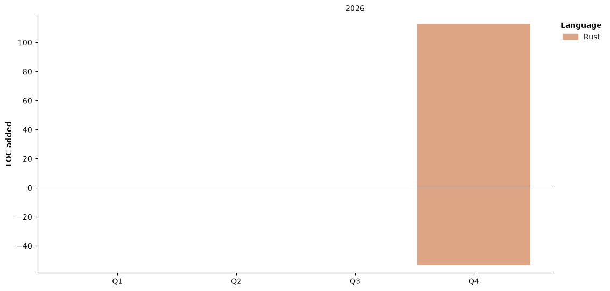

# Hey, I'm Nirk 👋

<p align="center">
  
</p>

<p align="center">
  <b>Indie Developer · Software Engineer · Open Source Enthusiast</b>
</p>

<p align="center">
  <a href="https://github.com/nirkzxc">
    
  </a>
  
</p>

I build software, experiment with technologies, and turn ideas into working products.

Interested in systems programming, desktop applications, AI-powered automation, and developer tools.

---

## 👨‍💻 About Me

```javascript
const nirk = {
    username: "nirkzxc",
    alias: "Нирк",
    role: "Indie Developer",

    languages: [
        "Python",
        "C",
        "C++",
        "C#",
        "Rust",
        "Go",
        "JavaScript"
    ],

    interests: [
        "Software Engineering",
        "Artificial Intelligence",
        "System Programming",
        "Automation",
        "Desktop Development",
        "Open Source"
    ],

    currentlyExploring: [
        "Local LLMs",
        "AI Agents",
        "Rust",
        "Operating Systems"
    ],

    philosophy: "Build. Break. Learn. Repeat."
};
```

## 🛠️ Tech Stack

**Languages**

<p>
  
</p>

**Frameworks & Tools**

<p>
  
</p>

## 🚀 Projects

| Project | Description | Language |
|:---|:---|:---:|
| [aeconv](https://github.com/nirkzxc/aeconv) | Extensible file conversion tool | Rust |
| [SoundCloud Desktop](https://github.com/NirkZxc/SoundCloud-Desktop) |	Desktop client experiment	| Rust / Tauri

More projects coming soon.


## 📊 GitHub Statistics

<p align="center">
  <a href="https://github.com/stats-organization/github-stats-extended">
    
  </a>
  
</p>


<p align="center">
  
</p>

## 📈 Contribution Activity

<p align="center">
  
</p>

## ⏱️ Coding Activity

<!--START_SECTION:waka-->


**🐱 My GitHub Data** 

> 📦 848 Bytes Used in GitHub's Storage 
 > 
> 🏆 14 Contributions in the Year 2026
 > 
> 🚫 Not Opted to Hire
 > 
> 📜 4 Public Repositories 
 > 
> 🔑 0 Private Repositories 
 > 
**I'm a Night 🦉** 

```text
🌞 Morning                0 commits           ░░░░░░░░░░░░░░░░░░░░░░░░░   00.00 % 
🌆 Daytime                3 commits           ████████░░░░░░░░░░░░░░░░░   30.00 % 
🌃 Evening                3 commits           ████████░░░░░░░░░░░░░░░░░   30.00 % 
🌙 Night                  4 commits           ██████████░░░░░░░░░░░░░░░   40.00 % 
```
📅 **I'm Most Productive on Monday** 

```text
Monday                   3 commits           ████████░░░░░░░░░░░░░░░░░   30.00 % 
Tuesday                  3 commits           ████████░░░░░░░░░░░░░░░░░   30.00 % 
Wednesday                1 commits           ██░░░░░░░░░░░░░░░░░░░░░░░   10.00 % 
Thursday                 1 commits           ██░░░░░░░░░░░░░░░░░░░░░░░   10.00 % 
Friday                   2 commits           █████░░░░░░░░░░░░░░░░░░░░   20.00 % 
Saturday                 0 commits           ░░░░░░░░░░░░░░░░░░░░░░░░░   00.00 % 
Sunday                   0 commits           ░░░░░░░░░░░░░░░░░░░░░░░░░   00.00 % 
```


📊 **This Week I Spent My Time On** 

```text
🕑︎ Time Zone: Europe/Moscow

💬 Programming Languages: 
Python                   9 hrs 15 mins       ████████████░░░░░░░░░░░░░   47.30 % 
Markdown                 2 hrs 8 mins        ███░░░░░░░░░░░░░░░░░░░░░░   10.97 % 
Other                    1 hr 20 mins        ██░░░░░░░░░░░░░░░░░░░░░░░   06.82 % 
RGBDS Assembly           1 hr 19 mins        ██░░░░░░░░░░░░░░░░░░░░░░░   06.77 % 
Rust                     44 mins             █░░░░░░░░░░░░░░░░░░░░░░░░   03.81 % 

🔥 Editors: 
Claude Code              18 hrs 17 mins      ███████████████████████░░   93.40 % 
Sublime Text             58 mins             █░░░░░░░░░░░░░░░░░░░░░░░░   04.98 % 
Codex CLI                15 mins             ░░░░░░░░░░░░░░░░░░░░░░░░░   01.29 % 
Copilot CLI              3 mins              ░░░░░░░░░░░░░░░░░░░░░░░░░   00.29 % 
Notepad++                0 secs              ░░░░░░░░░░░░░░░░░░░░░░░░░   00.03 % 

🐱‍💻 Projects: 
autovideo-velora         3 hrs 34 mins       █████░░░░░░░░░░░░░░░░░░░░   18.28 % 
public-proxy-monitor     3 hrs 24 mins       ████░░░░░░░░░░░░░░░░░░░░░   17.39 % 
ntos                     2 hrs 9 mins        ███░░░░░░░░░░░░░░░░░░░░░░   11.06 % 
My Website               1 hr 48 mins        ██░░░░░░░░░░░░░░░░░░░░░░░   09.21 % 
result111                1 hr 38 mins        ██░░░░░░░░░░░░░░░░░░░░░░░   08.42 % 
```

**I Mostly Code in Rust** 

```text
Rust                     2 repos             █████████████████░░░░░░░░   66.67 % 
Kotlin                   1 repo              ████████░░░░░░░░░░░░░░░░░   33.33 % 
```


**Timeline**




 Last Updated on 26/11/2026 06:27:40 UTC
<!--END_SECTION:waka-->

## 🧠 Currently Exploring

- Autonomous AI agents and multi-agent systems.
- Local LLMs and self-hosted AI infrastructure.
- Rust and systems programming.
- C# desktop application development.
- Operating systems and low-level engineering.
- Open-source developer tools.

## ⚡ Philosophy

- Build real things.
- Write clean and maintainable code.
- Experiment with unfamiliar technologies.
- Automate repetitive work.
- Learn by doing.

---

<p align="center">
  <i>"The best way to learn is to build something."</i>
</p>

<p align="center">
  
</p>
